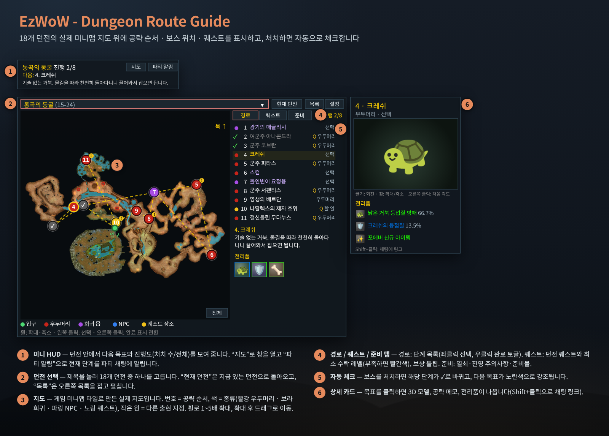
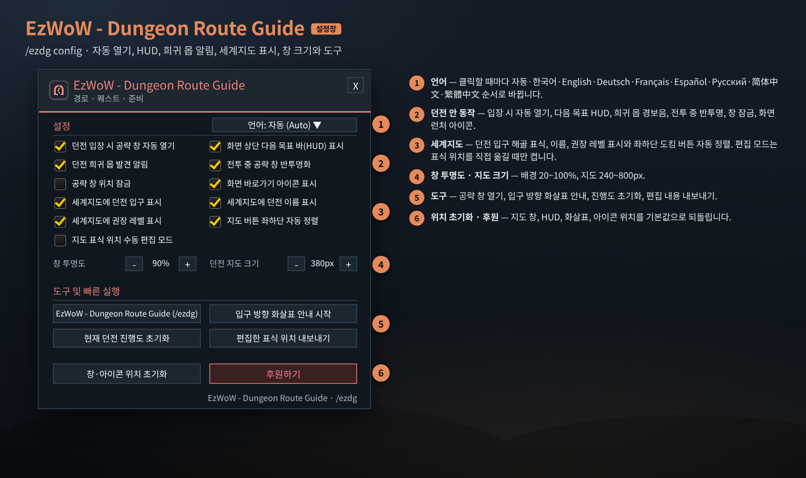
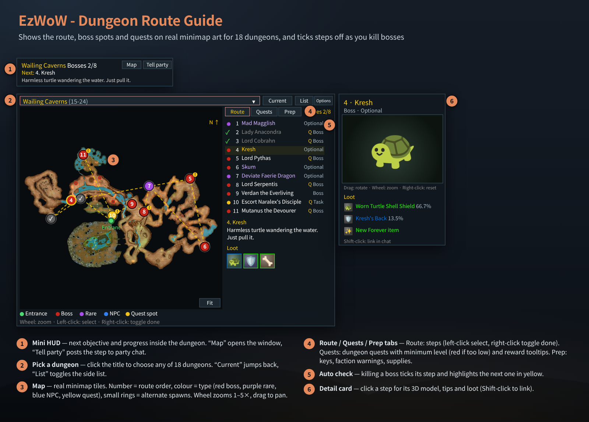
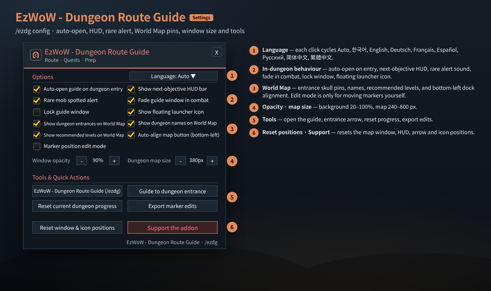

# EzWoW - Dungeon Route Guide (`EzWoW-DungeonRouteGuide`)

## CurseForge

- **Project ID / 프로젝트 ID:** `1728502`
- **Project page / 프로젝트 페이지:** [EzWoW-DungeonRouteGuide](https://www.curseforge.com/wow/addons/dungeonrouteguide)

**[한국어](#한국어) · [English](#english)**

WoW Forever (`Interface: 16001`) · `v1.0.16` · `/ezdg`

---

## 한국어

### 개요

던전 공략 길잡이입니다. **18개 던전, 29개 층 지도**에 게임 미니맵 타일로 만든 실제 지도를 넣고, 그 위에 **공략 순서 · 보스 · 희귀 몹 · 퀘스트 목표 위치**를 번호로 표시합니다. 던전에 들어가면 현재 던전과 층을 알아서 찾고, 보스를 잡으면 해당 단계를 자동으로 체크합니다. 던전 퀘스트 목록(최소 수락 레벨, 보상), 야외 입구 방향 화살표, 세계지도 던전 입구 표시도 함께 제공합니다.

| 지원 던전 (권장 레벨) | |
|---|---|
| 성난불길 협곡 (13-18) · 영주의 전당 (13-18) | 통곡의 동굴 (15-24) · 로데론의 폐허 (15-20) |
| 죽음의 폐광 (17-26) · 그림자송곳니 성채 (20-30) | 검은심연의 나락 (24-32) · 스톰윈드 지하감옥 (24-32) |
| 발굴 현장: 저습지 (26-31) · 달라란 (28-33) | 놈리건 (29-38) · 가시덩굴 우리 (29-38) |
| 붉은십자군 수도원 묘지 (30-38) · 도서관 (33-41) | 무기고 (36-44) · 대성당 (38-46) |
| 가시덩굴 구릉 (37-46) · 울다만 (41-51) | |

### 화면 미리보기

> 지도는 애드온에 들어 있는 미니맵 타일과 위치 데이터로 그린 **통곡의 동굴** 실제 지도입니다. 나머지 창은 애드온 코드의 크기·좌표·문구로 재현한 예시 화면입니다(3D 모델 자리에는 그림을 대신 넣었습니다).

### 설치

1. `EzWoW-DungeonRouteGuide` 폴더를 `Interface/AddOns/` 폴더에 넣습니다.
2. 캐릭터 선택 화면의 **애드온** 목록에서 켭니다.
3. 던전에 들어가면 공략 창이 자동으로 열립니다. 밖에서는 `/ezdg` 또는 화면 런처 아이콘(좌클릭)으로 엽니다.

### 화면 사용법 (위 그림의 번호)

| 번호 | 부분 | 설명 |
|---|---|---|
| ① | 미니 HUD | 던전 안에서 **다음 목표와 진행도(처치한 보스/전체)**, 짧은 공략 메모를 보여 줍니다. **지도** 버튼은 공략 창을 열고, **파티 알림**은 현재 단계를 파티 채팅에 알립니다. |
| ② | 던전 선택 | 제목(던전 이름)을 누르면 18개 던전 목록이 열립니다. **현재 던전**은 지금 있는 던전 지도로 돌아오고, **목록**은 오른쪽 목록을 접고 펼치며, **설정**은 설정창을 엽니다. 층이 여러 개인 던전은 층(지역) 선택 버튼이 나타납니다. |
| ③ | 지도 | 숫자 = 공략 순서, 색 = 종류(빨강 우두머리 · 보라 희귀 몹 · 파랑 NPC · 노랑 퀘스트 장소 · 초록 입구), 작은 원 = 무작위 출현 후보 지점, 점선 = 이동 경로. **마우스 휠**로 1~5배 확대, 확대 상태에서 **끌어서** 이동, **전체** 버튼으로 다시 맞춤. 표식을 누르면 상세 카드가 열리고, 파란 번호(층 연결)를 누르면 연결된 층 지도로 이동합니다. |
| ④ | 경로 / 퀘스트 / 준비 탭 | **경로**: 단계 목록(좌클릭 선택, 우클릭 완료 표시 전환). **퀘스트**: 이 던전 퀘스트의 시작·목표·보상, **최소 수락 레벨**(레벨이 부족하면 빨간색), 진행 상태. 좌클릭하면 던전 안 목표 위치, 우클릭하면 EzWoW-MapFinder로 세계지도 시작 위치를 찾습니다. **준비**: 입장 열쇠, 진영 주의사항(예: 달라란 호드 적대 경보), 추천 준비물. |
| ⑤ | 자동 체크 | 보스를 처치하면 그 단계가 ✓로 바뀌고 다음 목표가 **노란색**으로 강조됩니다. 새 인스턴스에 들어가면 진행이 자동으로 초기화됩니다. |
| ⑥ | 상세 카드 | 3D 보스 모델(끌기: 회전 · 휠: 확대 · 우클릭: 처음 각도), 공략 메모, 전리품과 드랍률. 아이템을 **Shift+클릭**하면 채팅에 링크합니다. 일반 몹 드랍 목록도 볼 수 있습니다. |

#### 그 밖의 기능

- **입구 방향 화살표**: 야외에서 선택한 던전 입구까지 방향과 남은 거리를 화살표로 안내합니다(`/ezdg go`, 끄기 `/ezdg go stop`, 런처 아이콘 우클릭).
- **세계지도 던전 입구**: 대륙·지역 지도에 해골 표식, 던전 이름, 권장 레벨을 표시하고, 가까이 붙은 입구(수도원 4구역 등)는 하나로 묶습니다. 세계지도 왼쪽 아래 **3번째 도킹 버튼**을 누르면 던전 검색 막대가 펼쳐지고, 이름을 입력해 **Enter**를 누르면 입구가 있는 지역 지도로 이동합니다.
- **단축키** (게임 단축키 설정 → 애드온): 공략 창 열기/닫기, 다음 목표 완료, 현재 단계 파티 알림.
- **수도원 구역 판별**: 붉은십자군 수도원 4개 구역을 자동으로 구분하며, 판별이 늦으면 `/ezdg wing 도서관`처럼 직접 고를 수 있습니다.

### 설정창 (`/ezdg config`)

| 번호 | 항목 | 설명 | 기본값 |
|---|---|---|---|
| ① | 언어 | 누를 때마다 자동 · 한국어 · English · Deutsch · Français · Español · Русский · 简体中文 · 繁體中文 순서로 바뀝니다. | 자동 |
| ② | 던전 입장 시 공략 창 자동 열기 | 인스턴스에 들어가면 지도 창을 엽니다. | 켬 |
| ② | 화면 상단 다음 목표 바(HUD) 표시 | 미니 HUD | 켬 |
| ② | 던전 희귀 몹 발견 알림 | 희귀(은테) 몹을 대상/마우스오버로 발견하면 경보음과 알림 | 켬 |
| ② | 전투 중 공략 창 반투명화 | 전투가 시작되면 창을 흐리게 | 켬 |
| ② | 공략 창 위치 잠금 | 지도 창과 HUD를 끌어도 움직이지 않게 | 끔 |
| ② | 화면 바로가기 아이콘 표시 | 런처 아이콘 | 켬 |
| ③ | 세계지도에 던전 입구 / 이름 / 권장 레벨 표시 | 세계지도 표식 | 켬 |
| ③ | 지도 버튼 좌하단 자동 정렬 | 세계지도 도킹 버튼 정렬 | 켬 |
| ③ | 게임 기본 던전 아이콘 숨기기 | 던전 입구 표시를 켠 동안 게임 기본 던전 입구 아이콘을 숨겨 한 번만 보이게 합니다. | 켬 |
| ③ | 지도 표식 위치 수동 편집 모드 | 단계를 고른 뒤 지도를 좌클릭해 표식을 옮기고, 우클릭으로 원래 자리로 되돌립니다. | 끔 |
| ④ | 창 투명도 · 던전 지도 크기 | 배경 20~100%, 지도 240~800px | 90% · 380px |
| ⑤ | 도구 | 공략 창 열기, 입구 방향 화살표 안내 시작, 현재 던전 진행도 초기화, 편집한 표식 위치 내보내기 | - |
| ⑥ | 창·아이콘 위치 초기화 · 후원하기 | 지도 창, HUD, 화살표, 아이콘 위치 초기화 | - |

### 명령어 (`/ezdg`, `/drg`, `/dungeonroute`, `/던전길잡이`)

| 명령어 | 설명 |
|---|---|
| `/ezdg` | 공략 지도 창 열기/닫기 |
| `/ezdg config` (`설정`) | 설정창 |
| `/ezdg hud` | 미니 HUD 표시/숨기기 |
| `/ezdg next` · `/ezdg undo` · `/ezdg reset` | 다음 단계 완료 · 되돌리기 · 현재 던전 진행 초기화 |
| `/ezdg wing <구역\|auto>` | 수도원 구역 직접 지정 / 자동 판별로 복귀 |
| `/ezdg go [던전키]` · `/ezdg go stop` | 입구 방향 화살표 시작 · 끄기 |
| `/ezdg entrance set` | 지금 위치를 그 던전 입구로 저장 |
| `/ezdg auto` · `/ezdg rare` · `/ezdg icon` | 자동 열기 · 희귀 몹 알림 · 런처 아이콘 켜기/끄기 |
| `/ezdg lock` · `/ezdg alpha 20~100` · `/ezdg size 240~800` | 창 잠금 · 투명도 · 지도 크기 |
| `/ezdg edit` · `/ezdg export` | 표식 편집 모드 · 편집 내보내기 |
| `/ezdg map` · `/ezdg debug` | 미니맵 다시 불러오기 · 던전 정보 확인 |
| `/ezdg lang <auto\|ko\|en\|de\|fr\|es\|ru\|zhCN\|zhTW>` | 표시 언어 변경 |

### 저장 데이터

- `EzWoW_DungeonRouteGuideDB` (계정 공통): 설정, 창 위치, 표식 편집, 입구 위치.
- `EzWoW_DungeonRouteGuideCharDB` (캐릭터별): 던전 진행 상황.

### 알아두면 좋은 점

- 지도는 위가 북쪽인 고정 지도입니다. 미니맵 회전 옵션을 켜 두면 미니맵과 방향이 다를 수 있습니다.
- “위치 미확인”으로 표시된 단계는 지도 표식 없이 목록에만 나옵니다.
- 퀘스트 우클릭 위치 검색은 `EzWoW-MapFinder`가 있어야 동작합니다.

---

## English

### Overview

A dungeon route guide. **18 dungeons and 29 floor maps** use real minimap-tile art, with the **route order, bosses, rares and quest spots** numbered on top. Inside a dungeon it detects the dungeon and floor, and ticks steps off automatically as bosses die. It also lists dungeon quests (minimum level, rewards), shows an outdoor arrow to the entrance and marks entrances on the World Map.

| Dungeons (levels) | |
|---|---|
| Ragefire Chasm (13-18) · The Hall of Thanes (13-18) | Wailing Caverns (15-24) · Ruins of Lordaeron (15-20) |
| The Deadmines (17-26) · Shadowfang Keep (20-30) | Blackfathom Deeps (24-32) · The Stockade (24-32) |
| Excavation Site: Wetlands (26-31) · City of Dalaran (28-33) | Gnomeregan (29-38) · Razorfen Kraul (29-38) |
| Scarlet Monastery Graveyard (30-38) · Library (33-41) | Armory (36-44) · Cathedral (38-46) |
| Razorfen Downs (37-46) · Uldaman (41-51) | |

### Screenshots

> The map is the real **Wailing Caverns** map drawn from the minimap tiles and position data bundled with the addon. The other windows are mock-ups rebuilt from the sizes, coordinates and strings in the code (a picture stands in for the 3D model).

### Installation

1. Copy the `EzWoW-DungeonRouteGuide` folder into `Interface/AddOns/`.
2. Enable it in the **AddOns** list on the character select screen.
3. The guide opens automatically when you enter a dungeon. Elsewhere, use `/ezdg` or left-click the launcher icon.

### Using the window (numbers in the picture)

| No. | Part | Description |
|---|---|---|
| ① | Mini HUD | Inside a dungeon: **next objective and progress (bosses killed / total)** with a short tip. **Map** opens the guide, **Tell party** posts the current step to party chat. |
| ② | Pick a dungeon | Click the title for the list of 18 dungeons. **Current** returns to the dungeon you are in, **List** toggles the side list, **Options** opens settings. Multi-floor dungeons show an area selector. |
| ③ | Map | Number = route order, colour = type (red boss · purple rare · blue NPC · yellow quest spot · green entrance), small rings = random spawn candidates, dashed line = path. **Mouse wheel** zooms 1–5×, **drag** to pan when zoomed, **Fit** resets. Click a marker for its detail card; click a blue link number to jump to the connected floor. |
| ④ | Route / Quests / Prep tabs | **Route**: step list (left-click select, right-click toggle done). **Quests**: start, objective and rewards for each dungeon quest, **minimum level** (red when too low) and status. Left-click shows the in-dungeon objective, right-click finds the quest start on the World Map with EzWoW-MapFinder. **Prep**: keys, faction warnings (e.g. Horde hostility in Dalaran), suggested supplies. |
| ⑤ | Auto check | Killing a boss ticks its step and highlights the next one in **yellow**. Progress resets automatically on a new instance. |
| ⑥ | Detail card | 3D boss model (drag: rotate · wheel: zoom · right-click: reset), tips, loot with drop chances. **Shift+click** an item to link it. Trash-drop lists are available too. |

#### More features

- **Entrance arrow**: outdoors, an arrow shows the direction and distance to the chosen dungeon entrance (`/ezdg go`, stop with `/ezdg go stop`, or right-click the launcher icon).
- **World Map entrances**: skull pins, names and recommended levels on continent and zone maps; entrances close together (the four Monastery wings) are grouped. The **3rd dock button** at the bottom-left of the World Map opens a dungeon search bar; type a name and press **Enter** to jump to the zone of its entrance.
- **Key bindings** (Key Bindings → AddOns): toggle the guide, mark next done, announce the current step.
- **Monastery wings**: the four Scarlet Monastery wings are detected automatically; if detection is slow, choose one with `/ezdg wing library` etc.

### Settings window (`/ezdg config`)

| No. | Option | Description | Default |
|---|---|---|---|
| ① | Language | Each click cycles Auto · 한국어 · English · Deutsch · Français · Español · Русский · 简体中文 · 繁體中文. | Auto |
| ② | Auto-open guide on dungeon entry | Opens the map window on entering an instance | On |
| ② | Show next-objective HUD bar | Mini HUD | On |
| ② | Rare mob spotted alert | Sound and alert when a rare (silver) mob is targeted or moused over | On |
| ② | Fade guide window in combat | Dims the window when combat starts | On |
| ② | Lock guide window | Map window and HUD cannot be dragged | Off |
| ② | Show floating launcher icon | Launcher icon | On |
| ③ | Show dungeon entrances / names / recommended levels on World Map | World Map pins | On |
| ③ | Auto-align map button (bottom-left) | World Map dock alignment | On |
| ③ | Hide default dungeon icons | While dungeon entrances are shown, hides the game's own entrance icons so each entrance appears once | On |
| ③ | Marker position edit mode | Pick a step, left-click the map to move its marker, right-click to restore it | Off |
| ④ | Window opacity · Dungeon map size | Background 20–100%, map 240–800 px | 90% · 380 px |
| ⑤ | Tools | Open the guide, start the entrance arrow, reset current dungeon progress, export marker edits | - |
| ⑥ | Reset window & icon positions · Support | Resets map window, HUD, arrow and icon positions | - |

### Slash commands (`/ezdg`, `/drg`, `/dungeonroute`, `/던전길잡이`)

| Command | Description |
|---|---|
| `/ezdg` | Open/close the map window |
| `/ezdg config` | Settings |
| `/ezdg hud` | Show/hide the mini HUD |
| `/ezdg next` · `/ezdg undo` · `/ezdg reset` | Mark next step done · undo · reset current dungeon progress |
| `/ezdg wing <wing\|auto>` | Choose the Monastery wing / return to auto detection |
| `/ezdg go [key]` · `/ezdg go stop` | Start · stop the entrance arrow |
| `/ezdg entrance set` | Save your current spot as the entrance |
| `/ezdg auto` · `/ezdg rare` · `/ezdg icon` | Toggle auto-open · rare alert · launcher icon |
| `/ezdg lock` · `/ezdg alpha 20-100` · `/ezdg size 240-800` | Lock window · opacity · map size |
| `/ezdg edit` · `/ezdg export` | Marker edit mode · export edits |
| `/ezdg map` · `/ezdg debug` | Reload minimap tiles · dungeon info |
| `/ezdg lang <auto\|ko\|en\|de\|fr\|es\|ru\|zhCN\|zhTW>` | Change display language |

### Saved data

- `EzWoW_DungeonRouteGuideDB` (account-wide): settings, window positions, marker edits, entrance spots.
- `EzWoW_DungeonRouteGuideCharDB` (per character): dungeon progress.

### Tips

- Maps are fixed north-up. With minimap rotation enabled, your minimap may face a different way.
- Steps marked “Spot unconfirmed” appear in the list but not on the map.
- Right-click quest location search requires `EzWoW-MapFinder`.

---

## Support / 후원

If you find this addon useful, you can support its development.

애드온이 도움이 되셨다면 개발 후원으로 응원해 주세요.

[Buy Me a Coffee ☕](https://buymeacoffee.com/qqhrqqhr2)

