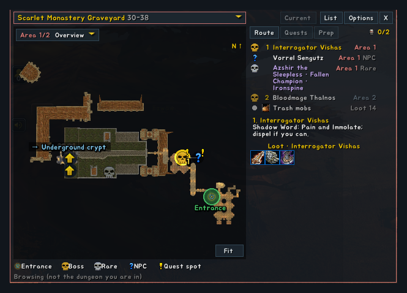
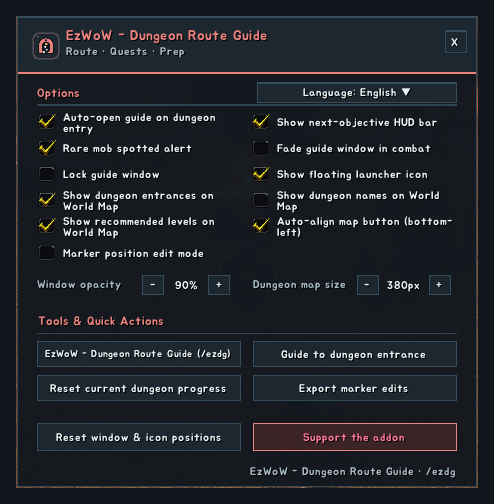
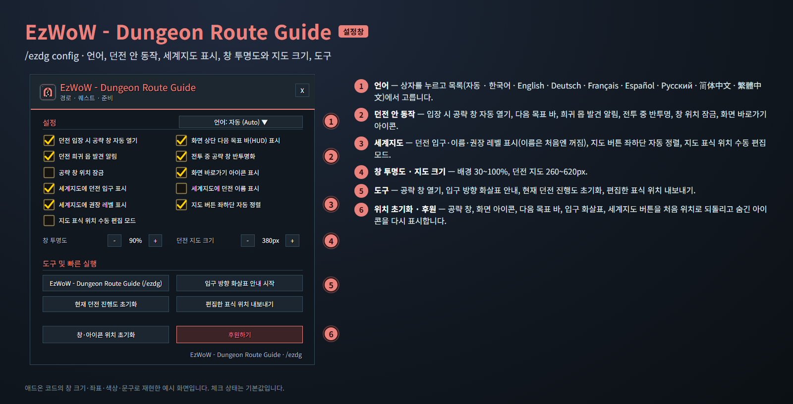

<!--
CurseForge summary (EN): Dungeon route guide for WoW Forever: real dungeon maps with boss order, auto check, loot, quests, entrance arrow and World Map entrances.
CurseForge summary (KO): 와우 포에버 던전 공략 길잡이: 실제 던전 지도 위 공략 순서, 자동 체크, 전리품, 던전 퀘스트, 입구 화살표, 세계지도 입구 표시.
-->

# EzWoW - Dungeon Route Guide

**English** · [한국어](#한국어)

A dungeon route guide for WoW Forever. **18 dungeons and 29 area maps** are drawn from real minimap art, with bosses, rares, NPCs and quest spots marked on top. Inside a dungeon it finds the dungeon and area on its own, ticks steps off as bosses die and shows the next objective. It also lists dungeon quests with minimum levels and rewards, guides you to the entrance with an arrow and marks entrances on the World Map.

*In-game screenshots with the addon set to English. The game client is Korean, so game text such as zone, item and spell names stays Korean. Character and player names and chat text are blurred.*

## Features

### Dungeons
Ragefire Chasm, The Hall of Thanes, Wailing Caverns, Ruins of Lordaeron, The Deadmines, Shadowfang Keep, Blackfathom Deeps, The Stockade, Excavation Site: Wetlands, City of Dalaran, Gnomeregan, Razorfen Kraul, Scarlet Monastery (Graveyard, Library, Armory, Cathedral), Razorfen Downs and Uldaman.

### Route window
- Opens by itself when you enter a dungeon; elsewhere use `/ezdg` or the launcher icon.
- Pick any dungeon from the title list (levels shown, the one you are in is marked). **Current** returns to the dungeon you are in.
- Map markers: numbers give the boss order, shapes and colours the type (gold skull boss, silver skull rare, NPC, quest spot, entrance, passage to another floor). Rares, NPCs and tasks get an icon, a yellow **!** marks quest targets, ✓ marks what is done and the next objective glows.
- Random spawns show their other possible spots when selected.
- Mouse wheel to zoom, drag to pan, **Fit** to reset. Multi-area dungeons get an area button with objectives left and a **Next objective → area** shortcut; blue link numbers jump to the connected area.

### Route, Quests and Prep tabs
- **Route**: every step in order (left-click select, right-click toggle done), the tip and loot icons of the selected step, and a trash-drop list.
- **Quests**: start, objective and rewards of each dungeon quest, the **minimum level** (red when you are too low) and your status. Right-click finds the quest start on the World Map with EzWoW - Map Finder.
- **Prep**: keys, faction warnings and suggested supplies.

### Auto check and next-objective bar
- Killing a boss ticks its step and highlights the next one. Progress resets on a new instance.
- A small bar at the top of the screen shows the next objective, progress (bosses killed / total) and a short tip, with **Map** and **Tell party** buttons.
- Rare mob alert with a sound when you target or mouse over a rare inside a dungeon.

### Detail card
- Click a marker or step to open a card next to the window: 3D model (drag to rotate, wheel to zoom, right-click to reset) and the loot list. Trash drops also show which mobs drop them and how often. Shift+click an item to link it.

### Entrances
- **World Map**: entrance pins on continent and zone maps, with optional names and recommended levels. Click a pin to open that dungeon's guide; Shift+click to start the entrance arrow and set a map waypoint.
- **Dungeon search**: the dock button at the bottom-left of the World Map opens a search bar; type a name and press Enter to jump to the zone of its entrance.
- **Entrance arrow**: outdoors, an arrow shows the direction and distance to the chosen entrance.

### Settings (`/ezdg config`)
- Language, auto-open, next-objective bar, rare alert, fade in combat, lock windows, launcher icon.
- World Map entrances, names (off by default) and recommended levels, map button alignment, marker edit mode.
- Window opacity (30–100%) and dungeon map size (260–620 px).
- Tools: open the guide, start the entrance arrow, reset dungeon progress, export marker edits, reset window and icon positions.
- Key bindings: toggle the guide, mark next done, announce the current step.

## Gamepad
- With the gamepad UI on, EzWoW windows work with a gamepad: D-pad to move, A (✕) to press, X (□) for right-click, LB/RB to scroll, B (○) to close. A key guide in your pad's button style shows under the window.
- With no game window open, press **View (Back) / Create** to move to the EzWoW frames on screen. Press it again or B to go back.
- On the World Map, View / Create moves to the EzWoW icons at the bottom left.
- To use another button: Key Bindings > AddOns > EzWoW > "Gamepad: move to / leave the EzWoW frames" (with EzWoW-MapFinder installed).

## Record sharing
- Shared by all EzWoW addons and **on by default**: quest NPCs, rare monster sightings, item drops and gathering spots you have seen yourself are shared with other EzWoW users.
- `/ezshare on` / `off`, `/ezshare channel on` / `off`, `/ezshare status`

## Commands
- `/ezdg` (also `/drg`, `/dungeonroute`, `/던전길잡이`) — open or close the guide
- `/ezdg config` — settings
- `/ezdg next` · `/ezdg undo` · `/ezdg reset` — mark next step done · undo · reset progress
- `/ezdg go [dungeon]` · `/ezdg go stop` — start or stop the entrance arrow
- `/ezdg wing <wing|auto>` — choose the Scarlet Monastery wing
- `/ezdg lang <auto|ko|en|de|fr|es|ru|zhCN|zhTW>` — display language

Languages: English, 한국어, Deutsch, Français, Español, Русский, 简体中文, 繁體中文.

---

## 한국어

와우 포에버용 던전 공략 길잡이입니다. **18개 던전, 29개 지역 지도**를 실제 미니맵 그림으로 그리고, 그 위에 우두머리·희귀 몹·NPC·퀘스트 장소를 표시합니다. 던전에 들어가면 지금 던전과 지역을 알아서 찾고, 우두머리를 잡으면 자동으로 체크하며 다음 목표를 알려 줍니다. 던전 퀘스트(최소 수락 레벨, 보상), 입구 방향 화살표, 세계지도 입구 표시도 함께 제공합니다.

*실제 게임 화면입니다(WoW Forever, 한국어 클라이언트). 캐릭터 · 다른 플레이어 이름과 채팅 내용은 가렸습니다.*

## 기능

### 지원 던전
성난불길 협곡, 영주의 전당, 통곡의 동굴, 로데론의 폐허, 죽음의 폐광, 그림자송곳니 성채, 검은심연의 나락, 스톰윈드 지하감옥, 발굴 현장: 저습지, 달라란, 놈리건, 가시덩굴 우리, 붉은십자군 수도원(묘지·도서관·무기고·대성당), 가시덩굴 구릉, 울다만.

### 공략 창
- 던전에 들어가면 자동으로 열립니다. 밖에서는 `/ezdg` 또는 화면 런처 아이콘으로 엽니다.
- 제목을 누르면 던전 목록(권장 레벨, 지금 있는 던전 표시)에서 아무 던전이나 고를 수 있습니다. **현재 던전**은 지금 있는 던전으로 돌아옵니다.
- 지도 표식: 숫자는 우두머리 순서, 모양·색은 종류(금색 해골 우두머리·은색 해골 희귀 몹·NPC·퀘스트 장소·입구·다른 층으로 가는 통로). 희귀 몹·NPC·할 일은 아이콘, 노란 **!**는 퀘스트 대상, ✓는 완료, 다음 목표는 빛납니다.
- 무작위로 나오는 몹은 선택하면 다른 출현 후보 지점도 보여 줍니다.
- 마우스 휠로 확대, 끌어서 이동, **전체**로 다시 맞춤. 지역이 여러 개인 던전은 남은 목표 수가 붙은 지역 선택 버튼과 **다음 목표 → 지역** 바로가기가 나오고, 파란 번호를 누르면 연결된 지역으로 이동합니다.

### 경로 · 퀘스트 · 준비 탭
- **경로**: 모든 단계를 순서대로(좌클릭 선택, 우클릭 완료 전환), 고른 단계의 공략 메모와 전리품 아이콘, 일반 몹 드랍 목록.
- **퀘스트**: 던전 퀘스트의 시작·목표·보상, **최소 수락 레벨**(레벨이 부족하면 빨간색), 진행 상태. 우클릭하면 EzWoW - Map Finder로 세계지도 시작 위치를 찾습니다.
- **준비**: 입장 열쇠, 진영 주의사항, 추천 준비물.

### 자동 체크와 다음 목표 바
- 우두머리를 처치하면 그 단계가 체크되고 다음 목표가 강조됩니다. 새 인스턴스에 들어가면 진행이 초기화됩니다.
- 화면 위쪽의 작은 바에 다음 목표, 진행도(처치한 우두머리/전체), 짧은 공략 메모와 **지도**·**파티 알림** 버튼이 나옵니다.
- 던전 안에서 희귀 몹을 대상이나 마우스오버로 발견하면 경보음과 함께 알려 줍니다.

### 상세 카드
- 표식이나 단계를 누르면 창 옆에 카드가 열립니다. 3D 모델(끌기 회전, 휠 확대, 우클릭 처음 각도)과 전리품 목록. 일반 몹 드랍은 떨구는 몹과 드랍률도 보여 줍니다. 아이템을 Shift+클릭하면 채팅에 링크합니다.

### 입구 안내
- **세계지도**: 대륙·지역 지도에 던전 입구 표식(이름·권장 레벨 표시는 선택). 표식을 클릭하면 그 던전의 공략 창, Shift+클릭하면 입구 방향 화살표 안내와 지도 목적지 표시.
- **던전 검색**: 세계지도 왼쪽 아래 도킹 버튼을 누르면 검색 막대가 펼쳐지고, 이름을 입력해 Enter를 누르면 입구가 있는 지역 지도로 이동합니다.
- **입구 방향 화살표**: 야외에서 고른 던전 입구까지 방향과 남은 거리를 보여 줍니다.

### 설정 (`/ezdg config`)
- 언어, 자동 열기, 다음 목표 바, 희귀 몹 알림, 전투 중 반투명, 창 잠금, 런처 아이콘.
- 세계지도 입구·이름(처음엔 꺼짐)·권장 레벨 표시, 지도 버튼 정렬, 표식 위치 편집 모드.
- 창 투명도(30~100%), 던전 지도 크기(260~620px).
- 도구: 공략 창 열기, 입구 화살표 안내, 진행도 초기화, 편집한 표식 내보내기, 창·아이콘 위치 초기화.
- 단축키: 공략 창 열기/닫기, 다음 목표 완료, 현재 단계 파티 알림.

## 게임패드
- 게임패드 UI를 켜면 EzWoW 창을 패드로 다룰 수 있습니다. 방향키로 이동, A(✕)로 누르기, X(□)로 오른쪽 클릭, LB/RB로 스크롤, B(○)로 닫기입니다. 창 아래에 연결된 패드 모양으로 키 안내가 나옵니다.
- 블리자드 창이 열려 있지 않을 때 **보기(Back) / Create 버튼**을 누르면 화면의 EzWoW 프레임으로 이동합니다. 다시 누르거나 B를 누르면 돌아갑니다.
- 세계지도에서는 보기 / Create 버튼으로 왼쪽 아래 EzWoW 아이콘에 갑니다.
- 다른 버튼을 쓰려면: 설정 > 단축키 > 애드온 > EzWoW > "게임패드: EzWoW 창으로 이동/돌아가기" (EzWoW-MapFinder 설치 시)

## 기록 공유
- 모든 EzWoW 애드온이 함께 쓰며 **기본으로 켜져 있습니다**. 직접 확인한 퀘스트 NPC, 희귀 몬스터 목격, 아이템 드롭, 채집 위치를 다른 EzWoW 사용자와 나눕니다.
- `/ezshare on` / `off` (또는 `/공유`), `/ezshare channel on` / `off`, `/ezshare status`

## 명령어
- `/ezdg` (`/drg`, `/dungeonroute`, `/던전길잡이`) — 공략 창 열기/닫기
- `/ezdg config` (`/ezdg 설정`) — 설정창
- `/ezdg next` · `/ezdg undo` · `/ezdg reset` — 다음 단계 완료 · 되돌리기 · 진행 초기화
- `/ezdg go [던전]` · `/ezdg go stop` — 입구 방향 화살표 시작 · 끄기
- `/ezdg wing <구역|auto>` — 붉은십자군 수도원 구역 직접 지정
- `/ezdg lang <auto|ko|en|de|fr|es|ru|zhCN|zhTW>` — 표시 언어

지원 언어: English, 한국어, Deutsch, Français, Español, Русский, 简体中文, 繁體中文.

---

**Support:** If you find this addon useful, you can support its development. [Buy Me a Coffee ☕](https://buymeacoffee.com/qqhrqqhr2)

**후원:** 애드온이 도움이 되셨다면 개발 후원으로 응원해 주세요. [Buy Me a Coffee ☕](https://buymeacoffee.com/qqhrqqhr2)

---

**Data credits:** Many boss and rare spots on the dungeon maps were worked out from monster spawn positions in **Classic-DB** of the CMaNGOS project ([cmangos/classic-db](https://github.com/cmangos/classic-db), GNU GPL v3). Its license ships with the addon (`LICENSE-DATA.md`).

**데이터 출처:** 던전 지도의 보스·레어 위치 상당수는 CMaNGOS 프로젝트의 **Classic-DB**([cmangos/classic-db](https://github.com/cmangos/classic-db), GNU GPL v3)의 몬스터 출현 위치로 계산했습니다. 라이선스 파일(`LICENSE-DATA.md`)을 애드온에 함께 넣었습니다.
